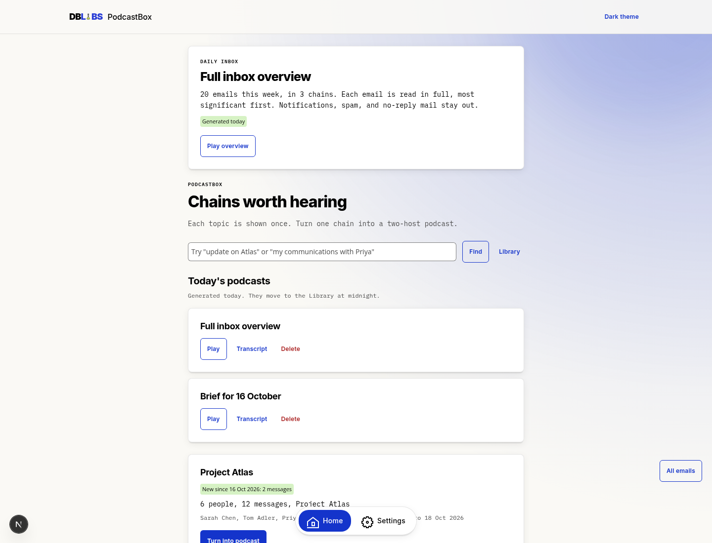
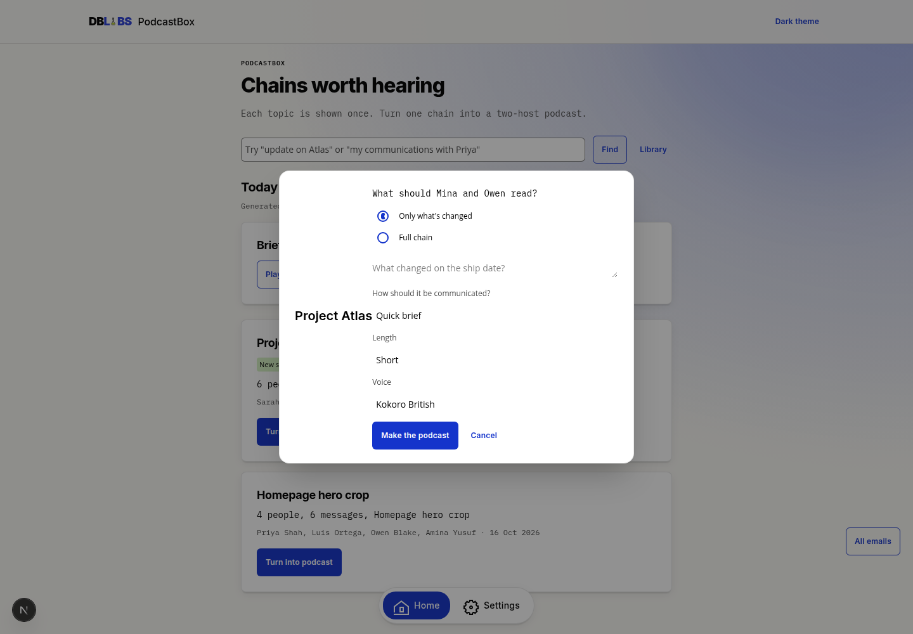
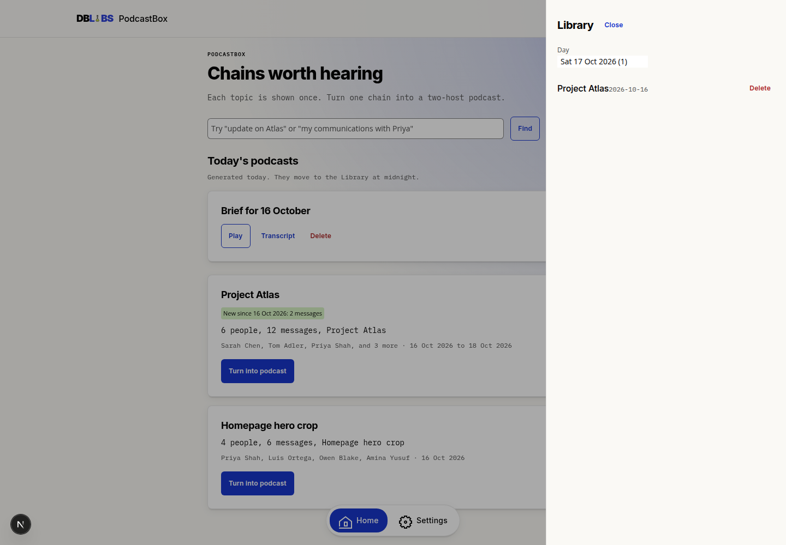
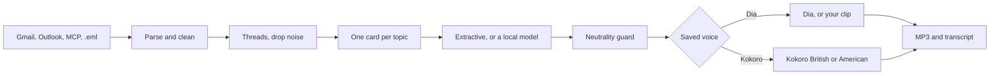

<p align="center">
  
</p>

<h1 align="center">PodcastBox</h1>

<p align="center"><strong>Turn email chains into podcasts. Privately.</strong></p>

<p align="center">
  <a href="LICENSE"></a>
  <a href="#privacy"></a>
  <a href="benchmark/REPORT.md"></a>
  
</p>

PodcastBox, by [DB Labs](https://github.com/dannybarr), reads a chain of email and has two hosts, Mina and Owen, speak only what the mail says. They name who wrote it. They do not rate it, advise anyone, or guess what happens next.

The sample mailbox is already curated. You can make a podcast before you connect an account.

<p align="center">
  
</p>

## Why it exists

A busy inbox is a pile of threads that are really one conversation, plus a lot of mail that is not a conversation at all. PodcastBox keeps one card per topic, drops the noise, and reads the part you have not heard yet. The audio stays on this machine. A cloud model is used only if you save a key.

## Features

- One card per topic, with the people, the message count, and a short reason.
- **Turn into podcast**. Ask a question, pick a length and a voice, then Mina and Owen read the chain.
- Today's podcasts stay on Home until midnight in your timezone (default Europe/London), then they move to the Library by day.
- A chain that gets new mail comes back with a badge such as **New since 16 Oct 2026: 2 messages**. You choose **Full chain** or **Only what's changed**.
- **All emails**, at the bottom right, lists every chain in the review period that is not noise.
- Gmail and Outlook, read-only, plus `.eml`, `.mbox`, and IMAP.
- An MCP server for your own tools, and an MCP client for Gmail and Microsoft 365 servers.
- Kokoro British (the default), Kokoro American, Dia, or My voice.

<p align="center">
  
  
</p>

## How curation works

Header threading runs first (`Message-ID`, `In-Reply-To`, `References`), then the provider thread id from Gmail or Graph. Local embeddings join separate threads about the same effort. A chain is recommended when enough people are writing, or when the mail names a project.

Noise never becomes a card: newsletters, calendar robots, receipts, reminders, and no-reply senders. Both main filters can be turned off, and you can add your own phrases.

The ask box returns a chain only when the question's words, a person's name, or an address actually match, or when the embedding is as close as two threads the curator would merge.

If you already heard a chain and mail arrives on a later day, Home shows it again. **Only what's changed** reads the new messages and one neutral line of earlier context. **Full chain** reads the lot. Covered message ids are stored with the episode, so the delta is exact.

**Full inbox overview**, at the top of Home, reads the whole review period in one podcast: every chain once, most significant first, with the same noise filter as All emails. The default is Full. Each email is read in full: who said what, the figures, the asks, the decisions, and the deadlines. Greetings, signatures, disclaimers, and quoted repeats are left out. Quick brief and Action focused remain shorter choices in the same dialog. When new mail arrives after that overview, refresh it with **Only what's new** or **Full**. It sits in Today's podcasts and moves to the Library at midnight.

## Privacy

PodcastBox is local-first.

- Mail, scripts, audio, and a My voice clip live in the data directory on this machine. The clip is `voice/mine.wav`. It is not sent to a public host.
- OAuth tokens and API keys are encrypted with a key that stays in that directory. Settings never returns the key.
- Ollama, Dia, and Speaches must be on localhost, a private address, or a single-label Docker name. The API refuses a public model host.
- A cloud model only with a saved key. OpenAI, Anthropic, or a compatible server receives mail text only after you choose that provider and save a key. Ollama is the private default and needs no key.
- There is no telemetry. There is no account. Do not publish port 43123 on the public internet.

## Quickstart

You need Docker Desktop, or Docker Engine with Compose.

```bash
docker compose up
```

Open [http://localhost:43123](http://localhost:43123). The first start downloads the models. That is several gigabytes. The sample edition does not need them, so you can press play while the downloads finish.

The sample mailbox was written for the week of 16 October 2026. On a later day the app moves those dates forward, keeping the gaps between them, so the chains still appear in this week's review. The words in the mail stay as written.

For the Dia voice, the computer also needs an NVIDIA GPU and the [NVIDIA container toolkit](https://docs.nvidia.com/datacenter/cloud-native/container-toolkit/latest/install-guide.html):

```bash
docker compose -f docker-compose.yml -f docker-compose.gpu.yml up
```

Without a GPU, leave the second file out. The default voice is Kokoro in British English.

### Gmail

1. In [Google Cloud Console](https://console.cloud.google.com/apis/credentials), create an OAuth client of type **Web application**.
2. Enable the Gmail API.
3. Add this authorised redirect URI: `http://127.0.0.1:8742/api/connect/gmail/callback`
4. Set the client id and secret (see `.env.example`) and restart the API:

```bash
INBOX_BRIEF_GOOGLE_CLIENT_ID=your-id
INBOX_BRIEF_GOOGLE_CLIENT_SECRET=your-secret
```

5. In Settings, press **Connect Gmail**, approve the read-only consent screen, then **Sync**.

The scope is `https://www.googleapis.com/auth/gmail.readonly`. A sync follows `nextPageToken` through the review period. It stops when the next page ends, or after 100 pages. A 429 waits for `Retry-After`, then tries again.

### Outlook and Microsoft 365

1. In [Azure app registrations](https://portal.azure.com/#view/Microsoft_AAD_RegisteredApps/ApplicationsListBlade), register an app.
2. Add a web redirect URI: `http://127.0.0.1:8742/api/connect/outlook/callback`
3. Under API permissions, add delegated **Mail.Read**, **User.Read**, and **offline_access**.
4. Create a client secret:

```bash
INBOX_BRIEF_MICROSOFT_CLIENT_ID=your-id
INBOX_BRIEF_MICROSOFT_CLIENT_SECRET=your-secret
INBOX_BRIEF_MICROSOFT_TENANT=common
```

5. In Settings, press **Connect Outlook**, then **Sync**.

The Graph call is `GET /me/messages` with `Mail.Read`. Drafts are skipped. A sync follows `@odata.nextLink` through the review period. It stops when a whole page is older than the period, when the link ends, or after 100 pages.

### MCP

PodcastBox is an MCP server at `POST /mcp`. Tools: `list_chains`, `search_chains`, `get_chain`, `list_messages`.

It is also an MCP client. Settings takes one server per line. An `http://` or `https://` line is streamable HTTP (JSON or server-sent events, with `Mcp-Session-Id`). A `stdio:` line runs a local command and speaks newline JSON-RPC. Shell pipelines are refused.

- Gmail: `@gongrzhe/server-gmail-autoauth-mcp`, tools `search_emails` and `read_email`. Example: `stdio:npx -y @gongrzhe/server-gmail-autoauth-mcp`
- Outlook and Microsoft 365: `@softeria/ms-365-mcp-server`, tools `list-mail-messages` and `get-mail-message`. Example: `http://127.0.0.1:3000/mcp` after `npx -y @softeria/ms-365-mcp-server --http`

A server that exposes PodcastBox's own `list_messages` tool is accepted too.

When a client id, secret, and a connected account are on the machine:

```bash
scripts/verify-connections
```

The script checks auth, list, fetch thread, and a local disconnect. It prints PASS, FAIL, or SKIP. SKIP means nothing was configured. Disconnect deletes the encrypted token on this machine after a thread was fetched. It does not revoke the grant at Google or Microsoft.

## Voices

| Choice | What you hear |
| --- | --- |
| Kokoro British | Mina `bf_emma`, Owen `bm_george`. The default. Preview: `demo/kokoro-british.mp3`. |
| Kokoro American | Mina `af_bella`, Owen `am_michael`. Preview: `demo/kokoro-ab.mp3`. |
| Dia expressive | Dia-1.6B two-host dialogue, with a few nonverbal cues. Preview: `demo/dia-sample.mp3`. |
| My voice | Your own 5 to 10 second clip for one host. The other host stays a stock Dia voice. |

**My voice** is optional. In Settings you record from the microphone, or upload a file, while reading:

> This is my voice for PodcastBox. I recorded it myself, in a quiet room, for use as one host.

Record in a quiet room, at 16 kHz or higher, with no music and no other voices. A checkbox is required: you confirm the recording is your own voice, and that it may be stored on this machine and used only as a host in your podcasts. The server rejects the upload without that confirmation. Delete removes the file. Do not upload someone else's voice.

Kokoro runs on CPU. Dia wants an NVIDIA GPU. If Dia is unavailable, the app falls back to Kokoro unless you chose My voice.

## Benchmark

`make benchmark` (or `npm run benchmark`) scores the product against the fixed rubric in `benchmark/RUBRIC.md`. The latest run is **115 / 120**.

| Metric | Score |
| --- | ---: |
| Connectivity and MCP robustness | 8 / 10 |
| Thread consolidation | 10 / 10 |
| Noise filtering | 10 / 10 |
| Suggestions and the ask box | 10 / 10 |
| Script faithfulness | 10 / 10 |
| Neutrality | 10 / 10 |
| Audio naturalness and emotion | 7 / 10 |
| UX simplicity | 10 / 10 |
| Day, library, and re-surface | 10 / 10 |
| Privacy and security | 10 / 10 |
| Reliability | 10 / 10 |
| Docs and onboarding | 10 / 10 |

Connectivity stays at 8 until `scripts/verify-connections` passes against a real mailbox. Audio stays at 7 until a person listens and writes `benchmark/listening.json`. Scores are not rounded up. Evidence is in `benchmark/REPORT.md`.

## Architecture



Every spoken line keeps the id of the email it came from. A judgement that is not already in the source is cut. A sentence with no overlap with its source is cut. If the guard removes everything, the edition fails instead of inventing a closer.

## Configuration

Copy `.env.example` if you run the API outside Docker. Compose sets the service URLs itself. Do not commit a filled-in `.env`.

| Setting | Default |
| --- | --- |
| Daily time | 07:30, timezone Europe/London |
| Review period | This week |
| Voice | Kokoro British (`bf_emma`, `bm_george`) |
| Model | Ollama `qwen3:8b`, fallback `llama3.2` |
| Cloud model | Only after you save a key |
| Noise filters | Newsletters and no-reply senders on |
| Data | `./data` or the `brief_data` volume |

| Piece | Rough size |
| --- | --- |
| `qwen3:8b` | about 5 GB |
| `llama3.2` | about 2 GB |
| Kokoro-82M | under 1 GB |
| Dia-1.6B | several GB |

Develop without Docker:

```bash
pip install -e "./server[dev]"
cd web && npm install && cd ..
INBOX_BRIEF_DATA_DIR=./data uvicorn inbox_brief.main:app --app-dir server --port 8742
```

In another terminal: `cd web && npm run dev`. The site is at [http://127.0.0.1:43123](http://127.0.0.1:43123).

Tests:

```bash
pip install -e "./server[dev]"
pytest server/tests
```

## Roadmap

- Keep Mina and Owen stable across a long edition by conditioning Dia on its own previous audio, still without cloning a person.
- A longer review window when a mailbox has more than 100 pages in the period.
- Dia2, if a build fits in 8 GB and the nonverbal controls stay as clear as Dia-1.6B.
- Sign-in for more than one person, and a calendar section.

## Contributing

Issues and pull requests are welcome. Keep the fixtures fictional. Do not commit secrets, OAuth tokens, API keys, or a real voice clip.

```bash
pytest server/tests
make benchmark
```

UK English in the interface. The neutrality guard is not optional.

## Licence

PodcastBox is [MIT](LICENSE), copyright DB Labs / Danny Barr.

| Piece | Licence | Role |
| --- | --- | --- |
| This repository | MIT | The app |
| [Lucide](https://lucide.dev) | ISC | Icons |
| Fraunces | SIL Open Font License 1.1 | Display type, self-hosted |
| Inter | SIL Open Font License 1.1 | UI type, self-hosted |
| JetBrains Mono | SIL Open Font License 1.1 | Kickers, self-hosted |
| [Dia-1.6B](https://github.com/nari-labs/dia) | Apache-2.0 | Expressive two-host voice |
| Descript Audio Codec | MIT | Dia's waveform |
| [Kokoro-82M](https://huggingface.co/hexgrad/Kokoro-82M) | Apache-2.0 | CPU voice |
| [Speaches](https://github.com/speaches-ai/speaches) | MIT | Serves Kokoro |
| [Ollama](https://github.com/ollama/ollama) | MIT | Serves the script model |
| [Qwen3](https://github.com/QwenLM/Qwen3) | Apache-2.0 | Default script model |
| FastAPI, Uvicorn, httpx | MIT / BSD | API |
| Next.js, React, Tailwind | MIT | Web interface |

Weights are downloaded by you. They are not in this repository, except the short Kokoro and Dia previews under `demo/`, rendered from fictional mail.

`fixtures/` is a fictional company, Northline Supply. Nothing in it is a real person's mail.
